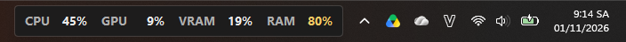
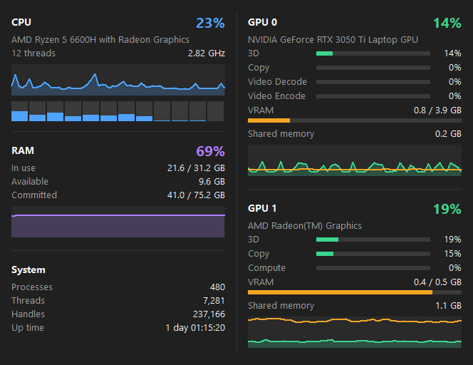
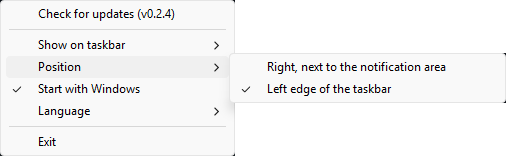

# Taskbar Monitor

Shows CPU, GPU, VRAM and RAM usage right on the Windows taskbar. Click it for details.





## Features

- **Lightweight**: a single ~350 KB exe using about 6 MB of RAM. No installer, no admin rights, no driver.
- **Same numbers as Task Manager**: CPU and GPU come from Performance Counters (PDH). Works with NVIDIA, AMD and Intel graphics, including multi-GPU laptops.
- **Detail panel**: per-thread CPU load, clock speed, RAM and commit charge, 3D / Copy / Video load per GPU, VRAM, and 60-second history graphs.
- Choose which metrics appear on the bar (CPU, GPU, VRAM, RAM) from the right-click menu. CPU, GPU and RAM are shown by default.
- Place the bar next to the notification area (default) or at the left edge of the taskbar, which is empty when the taskbar icons are centered.
- Values ≥ 60% turn yellow, ≥ 85% turn red.
- Hides automatically while a game or video is fullscreen.
- Updates itself from GitHub Releases.

The interface is available in English and Vietnamese. It follows the Windows display language by default and can be changed from the right-click menu.

## Install

With winget (once the package is approved):

```
winget install LamKieu.TaskbarMonitor
```

Or manually:

1. Download `taskbar-monitor.exe` from [Releases](https://github.com/kieusonlam/taskbar-monitor/releases/latest).
2. Put it in a permanent folder, e.g. `%LOCALAPPDATA%\Programs\TaskbarMonitor\`, and run it.
3. Right-click the bar and choose **Start with Windows**.

The exe is not code-signed yet, so SmartScreen may warn on first run: click **More info**, then **Run anyway**.

## Usage

| Action | Result |
|---|---|
| Left-click the bar | Open / close the detail panel |
| Esc or click elsewhere | Close the detail panel |
| Right-click the bar | Menu: check for updates, metrics shown on the taskbar, position, start with Windows, language, exit |



## Updates

The app checks for a new release 15 seconds after starting and then once a day. When one is available, a blue dot appears in the corner of the bar; right-click and choose **Update to vX.Y.Z**, and the app downloads the new exe, swaps it in and restarts.

Headless update, for scripts or deploying to many machines:

```
taskbar-monitor.exe --update
```

Exit code: `0` already up to date, `10` updated, `1` error.

## Build from source

Requires Rust with the MSVC toolchain:

```
cargo build --release
```

The binary is written to `target\release\taskbar-monitor.exe`.

## Releasing

1. Bump `version` in `Cargo.toml` and commit.
2. Push a matching tag: `git tag v0.2.0 && git push origin v0.2.0`.
3. GitHub Actions builds the exe and publishes the release. Installed copies pick it up within a day.

## Limitations

- Windows 11 no longer allows embedding into the taskbar, so the bar is a separate window placed over the taskbar. It only appears on the primary monitor's taskbar.
- The left position is only available with centered taskbar icons (with left-aligned icons the Start button is there). If the Widgets button is shown, the bar leaves room for it at a fixed width.
- No temperatures yet: reading CPU temperature requires a kernel driver.

## License

[MIT](LICENSE)
